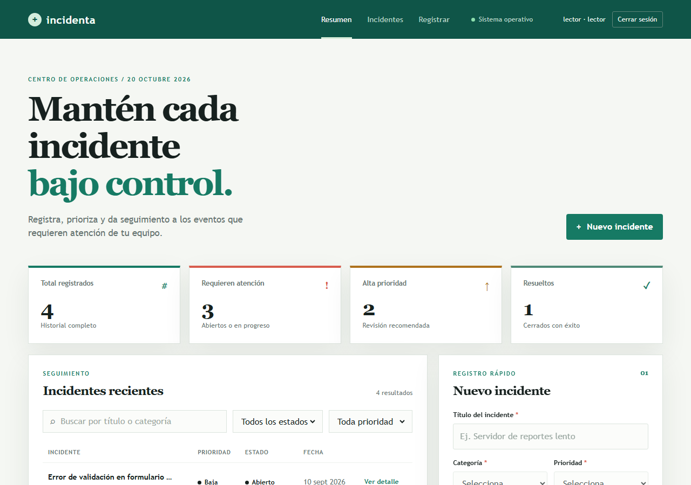
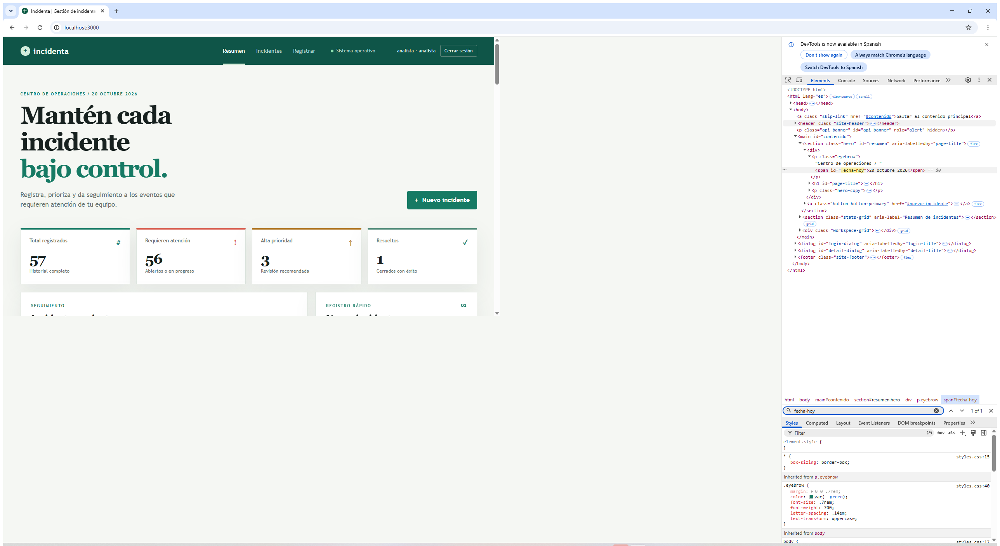
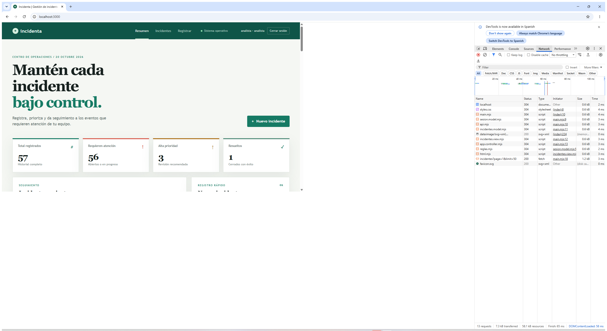
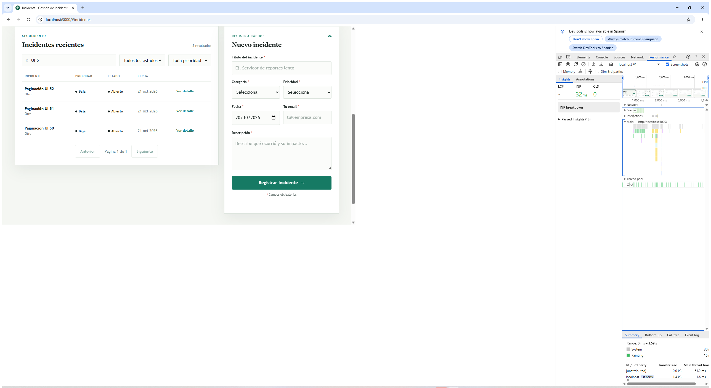

# Memoria técnica — Plataforma Incidenta

## 1. Propósito y alcance

Incidenta es una plataforma web para registrar, consultar, priorizar y seguir
incidentes. Esta entrega integra cliente, API y almacenamiento persistente;
autenticación, autorización por roles, validación, seguridad HTTP,
observabilidad básica, health check, pruebas, CI y configuración de
despliegue. La aplicación sirve una SPA tradicional en HTML/CSS/JavaScript
modular y una API REST dentro del mismo origen.

El proyecto se prepara para GitHub y para Render Free + Neon Free. En el
momento de esta memoria no se afirma que se haya publicado una URL o empujado
el código a un remoto: el entorno no está autenticado en las cuentas del
propietario y debe completarse el alta/conexión de los servicios indicada en
la guía de despliegue. Las capturas de la interfaz y DevTools son evidencia
gráfica real de ejecuciones locales previas; no prueban que exista un entorno
de producción.

## 2. Arquitectura y decisiones

La arquitectura separa rutas, controladores, modelos y middleware en servidor.
El cliente MVC organiza estado y reglas en `public/js/model/`, interacción DOM
en `public/js/view/`, y coordinación de eventos en
`public/js/controller/`. El modelo de cliente no accede al DOM. La capa de
persistencia está en `src/db/connection.js`, que usa `pg` en ejecución y
PGlite en pruebas. Las consultas se parametrizan y son asíncronas.

Se cambió SQLite por PostgreSQL para atender el requisito de persistencia en
un alojamiento sin costo: el disco de una instancia web gratuita suele ser
efímero, por lo que una base local podría perderse al reiniciar o desplegar.
Neon ofrece un servicio PostgreSQL con cuota gratuita; el cómputo escala a
cero y tiene límites. Por ello esta solución evita acoplar datos al disco del
web service, pero no promete disponibilidad continua ni un SLA gratuito. La
base PostgreSQL nueva se crea mediante migraciones versionadas. No se migra
automáticamente ningún archivo SQLite de una instalación anterior.

### Componentes

| Capa | Responsabilidad |
|---|---|
| Interfaz web | Inicio, listado, formularios, detalle, filtros y navegación |
| API REST | Contratos JSON, códigos HTTP, paginación y reglas de negocio |
| Middleware | Validación, JWT, roles, HTTPS, CORS, límite de login, gzip y logs |
| PostgreSQL | Datos persistentes, checks, índices, trigger e historial de migraciones |
| CI | Pruebas Jest/PGlite, integración HTTP y ESLint 9 con Node 22 |

## 3. Datos, API y control de acceso

`incidentes` conserva título, categoría, prioridad, estado, fecha, correo,
descripción y marcas temporales. `usuarios` almacena nombre de usuario,
correo, hash de contraseña, rol, activo y alta. Un índice único case-insensitive
impide duplicados por diferencias de mayúsculas. Los checks de base de datos
limitan prioridad, estado y rol. Un trigger actualiza `updated_at`.

`GET /api/incidentes` filtra por estado, prioridad y texto; pagina por defecto
50 y permite hasta 100 filas por petición. La respuesta tiene `data`,
`pagination` y `estadisticas`. El total respeta los filtros, las estadísticas
son globales. El CRUD usa códigos HTTP convencionales y conserva validación
antes de escribir.

El login emite JWT con vigencia configurada. Las contraseñas se hashean con
scrypt salado. Cada solicitud protegida consulta de nuevo la cuenta para
comprobar si fue desactivada y usar el rol vigente en base, evitando confiar
solo en el token. Lector consulta; analista consulta/crea/actualiza; admin
también elimina y puede crear usuarios. Las entradas se validan y limpian
antes de persistir; hay límites de tamaño de cuerpo y de intentos de login.

## 4. HTTPS, configuración y logs

En Render, TLS termina en el proxy gestionado por el proveedor. La aplicación
usa `TRUST_PROXY=1` para reconocer `X-Forwarded-Proto`, exige HTTPS y emite
HSTS cuando la conexión se reconoce segura. El navegador recibe HTML y API por
el mismo origen; la lista CORS queda cerrada si no se define una integración
cross-origin.

`DATABASE_URL`, `JWT_SECRET` y contraseñas iniciales se configuran como
variables secretas en el panel, nunca en el repositorio. En producción se
valida que la URL exista y que secretos iniciales tengan al menos 12
caracteres, letras y números. Las migraciones y datos de ejemplo se preparan
antes de aceptar peticiones. Cambiar el secreto inicial después de crear
cuentas no rota las claves existentes.

Los logs registran método, URL, estado, duración y usuario autenticado. Los
errores internos se redactan al cliente, mientras se registran en el servidor.
`GET /healthz` hace `SELECT 1` y responde `{"status":"ok"}` al estar lista la
base de datos; se configura como health check del servicio.

## 5. Pruebas y evidencias

La suite de reglas y modelo se ejecuta con Jest; PGlite brinda un motor
PostgreSQL local embebido para las pruebas sin depender de una cuenta cloud.
La integración usa Express real con `node:test`. Se comprueban CRUD, filtros,
paginación, restricciones, autenticación, roles, validaciones, cabeceras,
CORS, errores, límites y health check. GitHub Actions ejecuta `npm ci`,
`npm test` y `npm run lint` al hacer push a `main` o abrir una PR.

En la última ejecución local se aprobaron 74 pruebas Jest y 29 de integración;
ESLint 9 reportó cero errores y advertencias en 47 archivos. El recorrido real
de navegador generó 13 capturas para lector, analista y admin. El proyecto se
validó con Node v24.22.0; el flujo de CI está fijado en Node 22 y queda sujeto a
su primera ejecución tras publicar el repositorio.
`npm audit --omit=dev` no encontró vulnerabilidades en dependencias de
producción; el árbol completo conserva 19 alertas moderadas en herramientas de
desarrollo y pruebas.

La medición SQL actual ejecuta PGlite con 20 000 filas: listado completo,
mediana 284.2 ms; filtro de estado, 95.9 ms; búsqueda, 30.1 ms. La imagen WebP
de referencia mide 27 968 bytes. La carga fría transfirió 22 302 bytes y tardó
164.2 ms hasta `loadEventEnd`; la llamada API medida transfirió 2 348 bytes
comprimidos. Los datos y planes están en
`evidencias/mediciones/despues-postgres.json`. Los tiempos SQL incluyen el
motor embebido PGlite y transferencia de filas en este entorno, no son un
benchmark de Neon; tampoco son directamente comparables con los resultados
históricos SQLite incluidos en el informe anterior.

El recorrido Chromium local recién ejecutado generó 13 capturas para los
roles. Las capturas de DevTools son evidencia gráfica de sesiones locales
anteriores al cambio de persistencia:

*Figura 1. Interfaz real del cliente, sesión con rol lector.*

*Figura 2. Chrome DevTools Elements inspeccionando la fecha del encabezado.*

*Figura 3. Chrome DevTools Network muestra solicitudes y listado paginado.*

*Figura 4. Grabación real de Performance durante búsqueda filtrada.*

Las capturas anteriores al cambio PostgreSQL prueban el aspecto y la
interacción web local, no conectividad con Neon. La prueba automatizada actual
de PostgreSQL se realiza con PGlite, tampoco con Neon. La captura del panel
Sensors y una captura de alta POST de DevTools siguen pendientes; se describen
en `evidencias/devtools/CAPTURAS-MANUALES.md`.

## 6. Despliegue y límites

El Blueprint `render.yaml` configura Node, `npm ci`, `npm start` y
`/healthz`; la base Neon se provisiona por separado. Tras enlazar un repo
GitHub, configurar `DATABASE_URL` y secretos, el host obtiene un subdominio
HTTPS y redeploya al actualizar `main`.

Render Free puede dormir una instancia inactiva y demorar su reactivación.
Neon Free limita almacenamiento/cómputo y suspende compute tras inactividad.
No hay backup automático garantizado para la arquitectura gratuita documentada;
realizar `pg_dump` privado y ensayar restauración antes de datos reales. El
rate limiter actual es local a una instancia; para escalar horizontalmente
debe trasladarse a un almacén compartido. El despliegue gratuito se recomienda
como demo académica, no para incidentes operacionales o información sensible.

## 7. Reproducción

Consultar `docs/ARQUITECTURA-DESPLIEGUE.md` para publicar y
`docs/GUIA-USUARIO.md` para operar. Localmente: `npm ci`, completar `.env` con
PostgreSQL, `npm run migrate`, `npm run seed`, `npm start`, luego verificar
`/healthz`. En CI: `npm test` y `npm run lint`. Nunca incluir `.env`,
connection strings, credenciales ni datos de usuarios en capturas o Git.
